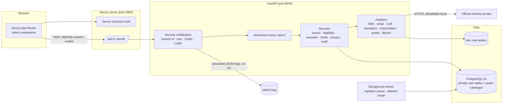
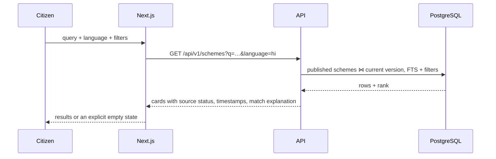
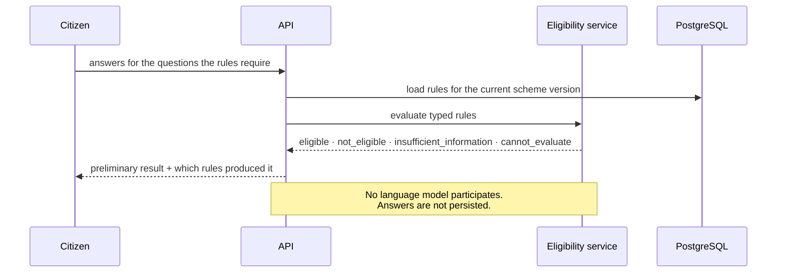
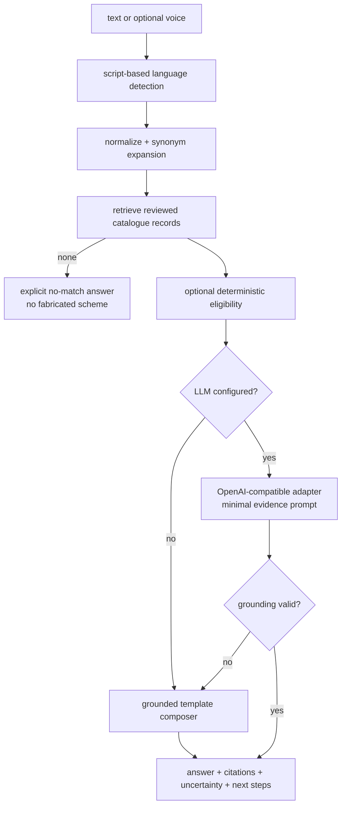

# Architecture and data flow

## Style

A modular monolith: one FastAPI process, one Next.js process, one PostgreSQL database,
and a separate background worker that shares the same code and database. Nothing in the
MVP justifies microservices, a message broker, a vector store or Kubernetes.

Trust boundaries:

1. Browser ↔ Next.js: untrusted input; React escapes output, forms validate again on the
   server.
2. Next.js ↔ FastAPI: same-origin rewrite in development; CORS allowlist plus CSRF
   double-submit token and Origin validation in the API.
3. API ↔ PostgreSQL: parameterised SQLAlchemy queries; least-privilege database user
   expected in production.
4. API ↔ official portals: SSRF-hardened fetcher, HTTPS only, host allowlist, private-IP
   and DNS-rebinding checks, redirect limits, response size limits.
5. API ↔ model/SMS providers: minimal fields, structured prompts, provider output treated
   as untrusted until schema and grounding validation pass.

## Module map (backend)

| Path | Responsibility |
| --- | --- |
| `app/main.py` | App factory, CORS, security middleware, generated OpenAPI |
| `app/core/config.py` | Typed settings, production guards, capability reporting |
| `app/core/security.py` | Argon2id, tokens, HMAC OTPs, TOTP, Fernet fields, phone/PIN validation |
| `app/core/middleware.py` | Request id, body-size cap, Origin check, CSRF check, security headers |
| `app/core/ratelimit.py` | Sliding-window limiter and documented per-route limits |
| `app/core/i18n.py` | Script detection, normalization, synonyms, assistant strings |
| `app/core/errors.py` | Stable error envelope and handlers |
| `app/models.py` | SQLAlchemy models, constraints, indexes, encryption helpers |
| `app/deps.py` | Session authentication, role/MFA dependencies, cookie issuance |
| `app/services/search.py` | Full-text search, filters, provenance-rich scheme detail |
| `app/services/eligibility.py` | Deterministic rule evaluation and question generation |
| `app/services/assistant.py` | Retrieval → grounding → optional LLM → validated answer |
| `app/services/drafts.py` | Draft lifecycle with per-field provenance |
| `app/services/privacy.py` | Export, deletion request, retention purge |
| `app/services/ingestion.py` | Approved-source fetch, hashing, versioning, review |
| `app/api/v1/*` | HTTP contracts, authorization dependencies, rate limits |

## Flows

### Search and scheme evidence

Ranking uses PostgreSQL `ts_rank_cd` over a maintained `search_text` column with the
`simple` configuration (works for Devanagari and Tamil tokens), plus synonym expansion
and a substring fallback. Generic words ("scheme", "yojana", "government") are removed
so an unrelated question does not return the whole catalogue.

### Eligibility

Precedence is deterministic: an unusable rule or source yields `cannot_evaluate`; a
failed rule yields `not_eligible`; a missing answer yields `insufficient_information`;
otherwise `eligible`. The response carries a disclaimer and never claims an official
determination.

### Multilingual assistant

Grounding validation rejects unknown citations, numbers not present in the evidence,
URLs not from the evidence, and answers that fail to name the cited scheme. Provider
failures fall back to the deterministic composer rather than an error page.

### Draft preparation

Drafts copy scheme questions into `draft_fields` with a source marker (`profile`, `user`,
`assistant`, `empty`). Profile values are proposed only when the citizen has consented
to reuse; every value can be edited or cleared. Export produces a document plus a
provenance list. **No submission happens**; the UI states this on every draft screen.

### Account deletion

`POST /api/v1/me/deletion` requires reauthentication and removes profile, address,
drafts, consents, search history, sessions, phone challenges and reset tokens immediately,
anonymises the user row, and schedules a hard delete after 30 days. The worker runs
`purge_expired_accounts` to complete it. Audit rows never contain personal data.

## Failure behaviour

| Failure | Behaviour |
| --- | --- |
| Database unavailable | `503` with error envelope; no partial writes |
| Provider unavailable | capability reported as disabled; assistant uses grounded fallback |
| Official link unreachable | shown as unverified with the check timestamp; never as working |
| Ambiguous or unknown PIN | explicit `multiple_matches` / `not_found`, no silent address edit |
| Rate limit exceeded | `429` with `Retry-After` |
| Unknown route | JSON `404` envelope, no stack traces |
