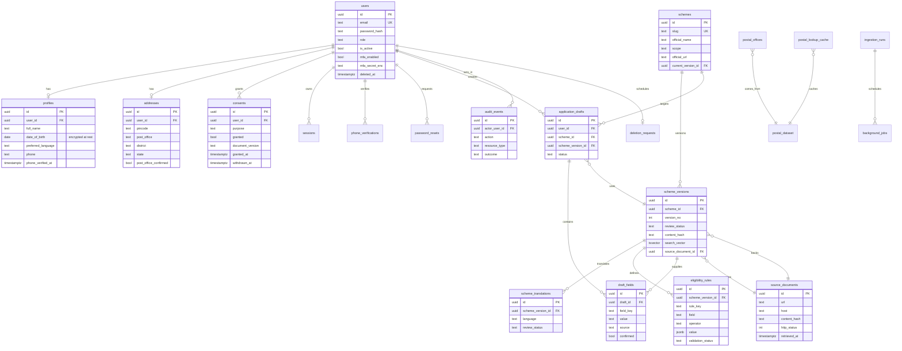

# Data model

All tables use UUID primary keys, `timestamptz` audit columns, foreign keys with
explicit delete behaviour, check constraints for enumerated values and indexes on
lookup and ownership columns. Migrations live in `backend/alembic/versions/` and are
applied with `alembic upgrade head`.

## Relationship diagram

## Separation of concerns

- **Public catalogue**: `schemes`, `scheme_versions`, `scheme_translations`,
  `eligibility_rules`, `source_documents`, `ingestion_runs`. Read by anonymous visitors.
- **Private citizen data**: `users`, `profiles`, `addresses`, `consents`, `sessions`,
  `phone_verifications`, `password_resets`, `application_drafts`, `draft_fields`,
  `deletion_requests`. Every read path filters by the authenticated user id.
- **Operational**: `audit_events`, `background_jobs`, `postal_lookup_cache`,
  `search_history`. A search row is written only for a signed-in citizen who has granted
  the optional `analytics` consent; anonymous searches are never stored.

## Sensitive fields

| Field | Protection |
| --- | --- |
| `users.password_hash` | Argon2id |
| `users.mfa_secret_enc` | Fernet (AES-128-CBC + HMAC), key outside the database |
| `profiles.date_of_birth` | EncryptedDate custom type (Fernet); decrypted only for the owner's profile view |
| `phone_verifications.code_hash` | HMAC-SHA256 keyed with the application secret |
| `sessions.token_hash` | SHA-256; the raw token exists only in the HttpOnly cookie |
| `password_resets.token_hash` | SHA-256, single use, short expiry |
| questionnaire answers | never persisted; evaluated in-request and discarded |

Key material comes from `HVA_SECRET_KEY` and `HVA_ENCRYPTION_KEY`. Production refuses
to boot with the development secret or without an explicit 32+ character secret.

## Constraints and indexes (selected)

- `schemes.slug` unique; `scheme_versions (scheme_id, version_no)` unique.
- `scheme_translations (scheme_version_id, language)` unique.
- `eligibility_rules (scheme_version_id, rule_key)` unique.
- `consents (user_id, purpose)` unique, so withdrawal updates one row.
- `draft_fields (draft_id, field_key)` unique.
- GIN index on `scheme_versions.search_vector`; index on `schemes.state_name`, category
  and `is_published`; index on `application_drafts.user_id`.
- Enum-like columns are `varchar` with `CHECK` constraints (`create_constraint=True`,
  `validate_strings=True`) rather than PostgreSQL enums, so adding a value is a
  migration-free data change guarded by application validation.

## Retention

| Data | Retention |
| --- | --- |
| Sessions | 12 hours from issue, revoked on logout/password change |
| Phone challenges | 10 minutes, deleted with the account |
| Password reset tokens | 30 minutes, single use |
| Deleted account personal data | removed immediately; account row hard-deleted after 30 days |
| Audit events | retained without personal data; hard delete removes the account-level rows for that user |
| Search queries | only for signed-in users with active analytics consent; removed with the account |
| Assistant messages | not stored; only a daily usage counter per user |
| Eligibility answers | not stored |

Backups are **not** configured in this repository. A production deployment must define
backup retention and a tested restore procedure; deletion cannot reach immutable backup
copies until they expire, which must be stated in the privacy notice before launch.
